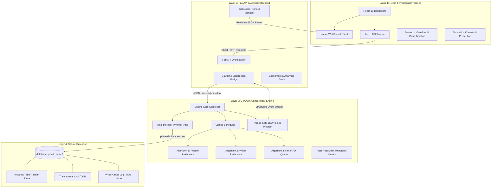

# SyncDB Lab — System Architecture & Design
## Readers–Writers Concurrent Database Simulator
### Project Group: G-15 | Course: Operating Systems Capstone

---

## 1. Executive Architecture Summary

**SyncDB Lab** is structured as an integrated four-layer system designed to demonstrate, benchmark, and visualize the classical Readers–Writers synchronization problem. Unlike simulated mockups, the entire concurrency control is realized using real **C11 POSIX Threads (`pthread`)**, synchronization primitives (mutexes, semaphores, condition variables), and true **SQLite3 ACID transactions** running in WAL (Write-Ahead Logging) mode.

The application strictly separates responsibilities into four distinct layers:



---

## 2. Layer-by-Layer Architectural Breakdown

### Layer 1: React & TypeScript Frontend
- **Framework & Tooling:** React 18, TypeScript 5, Vite 5, Tailwind CSS, Recharts, Lucide React.
- **Responsibilities:**
  - Real-time visualization of shared database gate state (Idle, Shared Reading, Exclusive Writing).
  - Gantt-style timeline plotting monotonic thread lifecycle phases (Arrival, Wait, Acquired, Critical Section, Release).
  - Interactive Simulation Control Lab with 7 presets and custom parameters.
  - Full CRUD Database Manager supporting deposits, withdrawals, and atomic transfers.
  - Performance analytics with Recharts (waiting times, throughput, and cross-policy comparisons).
  - Searchable, filterable activity logs with CSV/JSON export.

### Layer 2: FastAPI Backend (`backend/`)
- **Framework & Tooling:** Python 3.10+, FastAPI, Uvicorn, WebSockets, Pydantic v2.
- **Responsibilities:**
  - Manages the lifecycle of the persistent C engine subprocess.
  - Maintains a single authoritative simulation session per server process.
  - Request-response correlation over stdin/stdout pipes using unique request IDs (`req_id`).
  - Broadcasts engine state transitions to connected browser clients via WebSockets (`/ws/events`).
  - Maintains bounded in-memory histories for benchmark comparisons and analytics.
  - Safe error recovery, timeouts, and clean cooperative shutdown.

### Layer 3: Real C POSIX Concurrency Engine (`engine/`)
- **Framework & Tooling:** C11, `pthread` (POSIX Threads), SQLite3 C API, cJSON, CMake.
- **Responsibilities:**
  - Creates genuine OS threads (`pthread_create`) for every simulated reader and writer.
  - Implements 3 distinct synchronization algorithms:
    1. **Reader Preference:** Classical Courtois 1st Readers–Writers algorithm using `readcount_lock` and `resource_lock`.
    2. **Writer Preference:** Classical Courtois 2nd Readers–Writers algorithm using mutex and dual condition variables (`can_read`, `can_write`).
    3. **Fair FIFO Scheduling:** Starvation-resistant ticketed queue with adjacent reader batching.
  - Enforces the 8 synchronization invariants (e.g. `active_writers <= 1`, `if active_writer > 0 then active_readers == 0`).
  - Records microsecond-level monotonic timestamps (`CLOCK_MONOTONIC`) for true waiting and execution time measurements.
  - Emits JSON Lines over stdout with thread-safe serialization (`protocol_channel_t`).

### Layer 4: SQLite Database (`database/`)
- **Configuration:** Local database file `database/syncdb.sqlite3` with `PRAGMA journal_mode = WAL;` and `PRAGMA foreign_keys = ON;`.
- **Currency Representation:** All account balances are stored as 64-bit integers in Indian paise (1 INR = 100 paise) to prevent floating-point rounding errors.
- **Thread Safety:** Each worker thread opens an independent SQLite connection with `SQLITE_OPEN_FULLMUTEX` and a 10-second busy timeout.
- **ACID Transactions:** Writers execute within `BEGIN IMMEDIATE` transactions, ensuring atomic balance updates, constraint validation (no negative balances), and atomic multi-account transfers.

---

## 3. Inter-Process Communication (IPC) Protocol

FastAPI communicates with the C engine via bidirectional pipes (standard input and standard output) using JSON Lines (one JSON object per line, terminated with `\n`).

### 3.1 Command Format (FastAPI -> C Engine)
```json
{
  "command": "start_simulation",
  "req_id": "REQ-7f2a1b9c",
  "params": {
    "readers_count": 5,
    "writers_count": 2,
    "policy": "READER_PREFERENCE",
    "reader_workload_ms": 800,
    "writer_workload_ms": 1200,
    "arrival_pattern": "BURST",
    "account_id": "ACC001",
    "writer_op_type": "DEPOSIT"
  }
}
```

### 3.2 Response Format (C Engine -> FastAPI)
```json
{
  "type": "response",
  "seq": 4,
  "timestamp_ms": 1792168642012,
  "req_id": "REQ-7f2a1b9c",
  "success": true,
  "data": {
    "experiment_id": "EXP-1792168642-4912",
    "total_operations": 7,
    "status": "RUNNING"
  },
  "error": null
}
```

### 3.3 Event Format (C Engine -> FastAPI -> WebSocket Broadcast)
```json
{
  "type": "event",
  "seq": 15,
  "timestamp_ms": 1792168643150,
  "monotonic_ms": 114890.25,
  "exp_id": "EXP-1792168642-4912",
  "op_id": "OP-003",
  "role": "READER",
  "event": "ACQUIRED",
  "state": "READING",
  "account_id": "ACC001",
  "policy": "READER_PREFERENCE",
  "metrics": {
    "active_readers": 3,
    "active_writers": 0,
    "waiting_readers": 1,
    "waiting_writers": 2
  },
  "details": {
    "wait_duration_ms": 14.8
  }
}
```

---

## 4. Concurrency Flow Diagram

```mermaid
sequenceDiagram
    autonumber
    actor User as Student / Evaluator
    participant UI as React UI (Dashboard)
    participant API as FastAPI Backend
    participant Engine as C POSIX Engine
    participant Sched as Scheduler Core
    participant SQLite as SQLite Database (WAL)

    User->>UI: Click "Start Simulation" (5 Readers, 2 Writers)
    UI->>API: POST /api/simulations
    API->>Engine: {"command":"start_simulation", "req_id":"REQ-01", ...}
    Engine->>Sched: scheduler_init(POLICY_READER_PREF)
    Engine->>Engine: Spawn 7 pthread worker threads
    Engine-->>API: {"type":"response", "success":true}
    API-->>UI: 200 OK (Simulation Running)

    par Reader Threads (R1..R5)
        Engine->>Sched: scheduler_reader_lock("OP-001")
        Sched-->>Engine: Lock Granted (Shared)
        Engine->>API: Event: OP-001 ACQUIRED (Reading)
        API->>UI: WS Broadcast (active_readers: 1..5)
        Engine->>SQLite: SELECT * FROM accounts WHERE account_id='ACC001'
        Engine->>Sched: scheduler_reader_unlock("OP-001")
    and Writer Threads (W1..W2)
        Engine->>Sched: scheduler_writer_lock("OP-006")
        Note over Sched: Waiting for active_readers == 0
        Sched-->>Engine: Lock Granted (Exclusive)
        Engine->>API: Event: OP-006 ACQUIRED (Writing)
        API->>UI: WS Broadcast (active_writers: 1, active_readers: 0)
        Engine->>SQLite: BEGIN IMMEDIATE; UPDATE accounts ...; COMMIT;
        Engine->>Sched: scheduler_writer_unlock("OP-006")
    end

    Engine->>API: Event: EXPERIMENT_FINISHED
    API->>UI: WS Broadcast (Status: IDLE)
    UI->>User: Update Dashboard & Performance Charts
```

---

## 5. Security, Reliability, and Error Handling

1. **Memory Safety & Leaks:** Out-of-source CMake builds, prepared statement cleanup, explicit closing of SQLite handles per thread, and dynamic queue node deallocation.
2. **Cooperative Cancellation:** The `scheduler_stop()` function safely broadcasts to all condition variables, waking blocked threads so they unwind and terminate cleanly without leaving orphaned threads or dangling mutexes.
3. **No Shell Injections:** All subprocess arguments are passed as discrete token arrays (`argv`), preventing shell interpolation of user inputs.
4. **Data Races Elimination:** Mutex-protected metrics counters and sequential stdout flushing prevent race conditions in telemetry and invariant checking.
